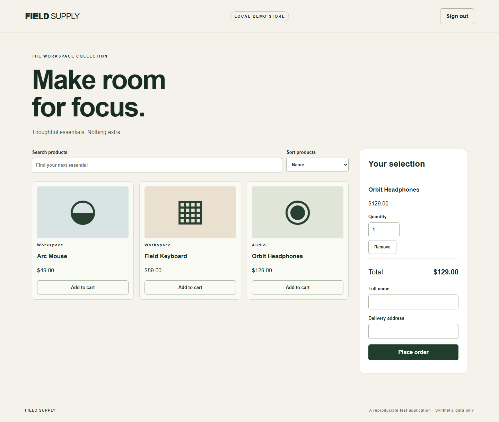

# Commerce Playwright QA

A runnable QA portfolio for a small e-commerce application. Tests exercise a real local HTTP service: sign-in, catalog, cart and checkout, plus controlled failure scenarios and accessibility checks.

[Русская версия](README.ru.md) · [Architecture](docs/architecture.md) · [Test matrix](docs/test-matrix.md) · [Review walkthrough](docs/review-guide.md)

**Stack:** TypeScript · Playwright · axe-core · Node.js 24 · GitHub Actions



Actual application screenshot; [mobile view](docs/demo-mobile.png). Recreate with `npm run demo:capture`.

## Quick start

Install **Node.js 24** and run from this repository:

```sh
npm ci
npx playwright install chromium firefox
npm run check
npm test
npm run test:report
```

On Linux, install browser system dependencies with `npx playwright install --with-deps chromium firefox`.
Playwright starts/stops the application automatically. Port **4173 must be free**; an existing server is never silently reused.

```sh
npm run test:smoke                   # four critical journeys per browser
npm test -- --project=chromium       # one browser
npm run test:ui                      # interactive runner
npm start                           # browse the fixture at http://127.0.0.1:4173
```

Demo sign-in is prefilled: `demo@example.test` / `Demo-pass-123`. All products, addresses and orders are synthetic.

## What this demonstrates

- **22 scenarios × 3 configurations:** Chromium, Firefox and a mobile Chromium viewport.
- Page/Component Objects with explicit `open()` methods and injected Playwright fixtures.
- Russian scenario and hook titles, with stable test IDs and `@smoke` tags.
- Explicit `beforeEach` setup and `afterEach` session cleanup; Playwright owns page/context teardown and worker-level browser shutdown.
- API-based setup with browser-context cookie isolation; UI authentication tested separately.
- Order verification through the API after completing the UI journey.
- Server-side totals, cart boundaries, negative paths, and isolated sessions.
- Explicit network fault injection with recovery checks.
- Automated WCAG A/AA checks with axe; keyboard sign-in and viewport overflow checks.
- HTML/JUnit reports; trace, screenshot and video retained for failures; no retries hiding failures.

## Structure

```text
tests/specs/       business scenarios and assertions
tests/pages/       user actions and component locators
tests/fixtures.ts  object injection and additional context lifecycle
tests/data/        deterministic synthetic data
tests/support/     API setup and post-condition helper
app/               local application under test
docs/              architecture, risk matrix, review guide
```

The [CI workflow](.github/workflows/tests.yml) installs from the lockfile, checks TypeScript and JavaScript syntax, runs all configurations and uploads reports. CI status is only established after the workflow actually runs on GitHub.

## Limits

The application uses in-memory sessions and orders. It has no payment provider, stock reservation, durable database or production auth. Mobile means viewport/device emulation, not a physical device. Axe detects only a subset of accessibility issues; this is not an accessibility certification. Route interception appears only in resilience scenarios.

The suite tests this repository's fixture, so it demonstrates automation design and invariant checking rather than compatibility with a third-party production shop. The intended next step is adapting these layers to a real system's documented contract.

## License

[MIT](LICENSE).
