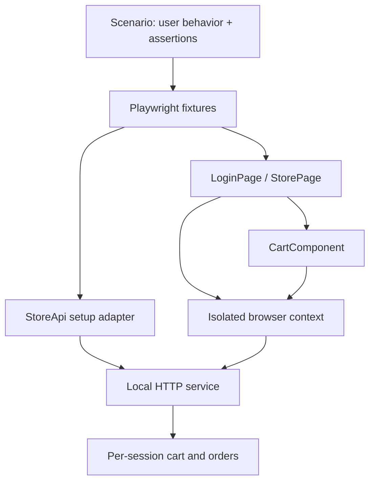

# Architecture and decisions

## ADR 001 — Own the test environment

**Decision:** ship a Node HTTP fixture with deterministic catalog data.
**Reason:** each clone can reproduce failures without an external demo service changing its behavior.
**Tradeoff:** the fixture is smaller than a production application. This is not evidence of production scalability.

## ADR 002 — Composition and explicit fixtures

**Decision:** StorePage owns CartComponent; Playwright injects page, API helper and authentication.
**Reason:** the cart has its own controls and locators. Composition avoids an inheritance tree and a catch-all BasePage.
**Boundary:** page objects perform actions; scenario files express expected business behavior. StoreApi checks setup preconditions so broken preparation fails immediately.

Authentication uses `page.request`, sharing cookies with exactly one browser context. Each login creates an independent server-side session. Teardown logs that session out. Tests of login itself use an unauthenticated page. The second context in the isolation test is explicitly closed.

## ADR 003 — Diagnostics without hidden retries

**Decision:** zero retries locally and in CI; failure artifacts retained.
**Reason:** an intermittent failure should remain visible. A healthy run needs neither a fixed delay nor a lucky retry.
**Tradeoff:** transient runner failures require diagnosis. Set CI worker count explicitly to reduce resource contention.

## ADR 004 — Money and trust boundaries

Prices are integer cents. The server calculates totals from its catalog and session cart; it ignores a client-supplied total. Checkout clears the cart only after successful server validation. ORDER-03 directly checks that price manipulation fails.

## ADR 005 — Accessibility and resilience scope

Axe checks rendered login and populated-cart states. Keyboard sign-in and horizontal overflow are separate observable checks. These do not claim full WCAG compliance.

Only RES-01/02 intercept HTTP responses. Their purpose is to exercise visible failure/recovery states. The normal checkout test reaches the real application service.

## Extension points

Add a page/component for a new surface, a data factory for new input variants, or a spec for a new risk. Replace StoreApi and page locators when adapting to another application; preserve the business intent of the scenarios.
