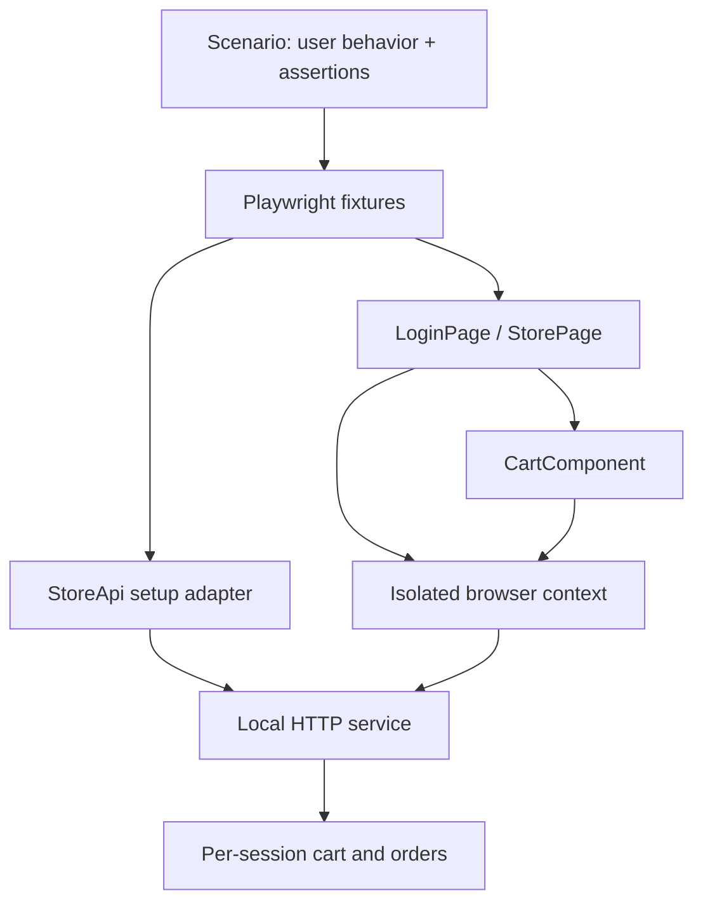

# Architecture and decisions

## ADR 001 — Own the test environment

**Decision:** ship a Node HTTP fixture with deterministic catalog data.
**Reason:** each clone can reproduce failures without an external demo service changing its behavior.
**Tradeoff:** the fixture is smaller than a production application. This is not evidence of production scalability.

## ADR 002 — Composition and explicit fixtures

**Decision:** StorePage owns CartComponent; Playwright injects page objects and the API helper. `LoginPage.open()` and `StorePage.open()` navigate and wait for their respective views. Spec-level `beforeEach` hooks explicitly prepare authentication and open the required page.
**Reason:** the cart has its own controls and locators. Composition avoids an inheritance tree and a catch-all BasePage.
**Boundary:** page objects perform actions; scenario files express expected business behavior. StoreApi checks setup preconditions so broken preparation fails immediately.

Authentication uses `context.request`, sharing cookies with exactly one browser context. The `api` fixture does not log in implicitly, and page-object construction does not navigate. Tests of login itself open an unauthenticated page. UI selectors and interactions live in page/component objects; network interception and axe analysis remain in the specs.

Each spec registers an `afterEach` hook that logs out the current session, including sessions created through the UI. Logout accepts HTTP 200 or 401 because anonymous and already-signed-out scenarios have no active session. Other cleanup failures fail the test. Registering the hook in every spec avoids relying on a shared module's import-time hook registration.

Playwright's built-in fixtures close the test's pages and browser context after the hooks, including on failure, and preserve configured failure artifacts. The browser is shared within a worker and closes when that worker finishes; calling `browser.close()` in `afterEach` would break subsequent tests in that worker. See the [official fixture lifecycle](https://playwright.dev/docs/test-fixtures#execution-order).

The `secondSessionApi` fixture owns the manually created context used by CART-05. Its teardown logs out that session and closes the context in nested `finally` blocks, so a logout failure cannot skip context closure. `StorePage.open()` waits for the store view rather than successful catalog loading, allowing RES-01 to exercise the unavailable-catalog state.

## ADR 003 — Diagnostics without hidden retries

**Decision:** zero retries locally and in CI; failure artifacts retained.
**Reason:** an intermittent failure should remain visible. A healthy run needs neither a fixed delay nor a lucky retry.
**Tradeoff:** transient runner failures require diagnosis. Set CI worker count explicitly to reduce resource contention.

## ADR 004 — Money and trust boundaries

Prices are integer cents. The server calculates totals from its catalog and session cart; it ignores a client-supplied total. Checkout clears the cart only after successful server validation. ORDER-03 directly checks that price manipulation fails.

## ADR 005 — Accessibility and resilience scope

Axe checks rendered login and populated-cart states. Keyboard sign-in and horizontal overflow are separate observable checks. These do not claim full WCAG compliance.

Only RES-01/02 intercept HTTP responses. Their purpose is to exercise visible failure/recovery states. The normal checkout test reaches the real application service.

## Extension points

Add a page/component for a new surface, a data factory for new input variants, or a spec for a new risk. Replace StoreApi and page locators when adapting to another application; preserve the business intent of the scenarios.
